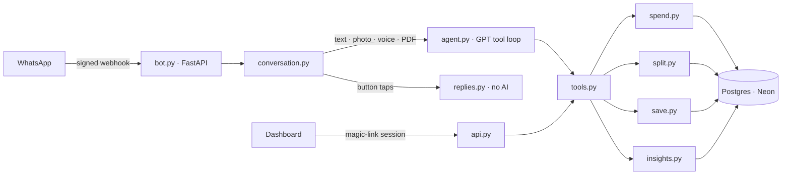

# Spenzo - your personal finance buddy on WhatsApp

Spenzo lives in WhatsApp. Track what you spend, split bills with friends, save for goals and keep an eye on your investments, all by chatting. No app, no forms, no passwords: your WhatsApp number is your account.

## Features

<table>
  <tr>
    <td width="33%" valign="top"><br><b>Log a spend in a second</b><br><sub>“chai 20” is logged and Spenzo just reacts ✅</sub></td>
    <td width="33%" valign="top"><br><b>Forward your bank statement</b><br><sub>The whole month in one go; locked PDFs ask for the password</sub></td>
    <td width="33%" valign="top"><br><b>Snap the bill</b><br><sub>Bills and payment screenshots are read and logged</sub></td>
  </tr>
  <tr>
    <td width="33%" valign="top"><br><b>Split with friends</b><br><sub>Your share is logged and everyone else’s is tracked</sub></td>
    <td width="33%" valign="top"><br><b>Goals that cheer you on</b><br><sub>Baaz sends a sticker halfway and at the finish</sub></td>
    <td width="33%" valign="top"><br><b>Your month, Wrapped</b><br><sub>A shareable card of last month’s highlights</sub></td>
  </tr>
</table>

## How it works


```
server/        the bot: WhatsApp webhook, agent and tools, dashboard API, pictures (Pillow)
website/       Vite + React + Tailwind: landing page, dashboard, pay page, privacy
scripts/       database setup, local bot with a tunnel, Meta webhook setup, live WhatsApp test
schema.sql     the tables
brand/         Baaz the mascot
```

## Run it locally

Needs Python 3.12+, uv and Node 22.

```bash
uv sync
cp .env.example .env                 # OPENAI_API_KEY is enough for the simulator
uv run python -m server.chat --memory  # a WhatsApp-style chat in the terminal, throwaway database
cd website && npm install && npm run dev
```
