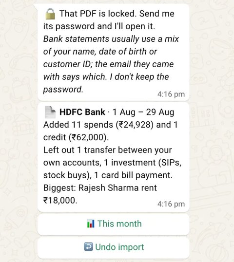
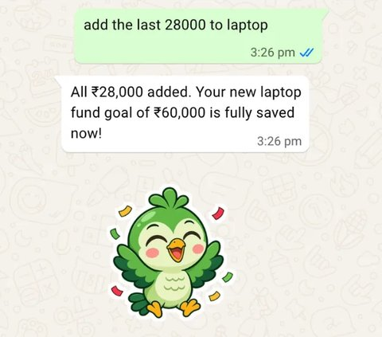
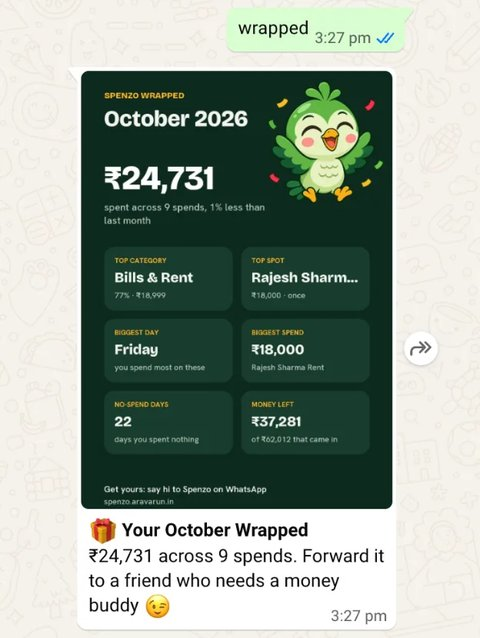
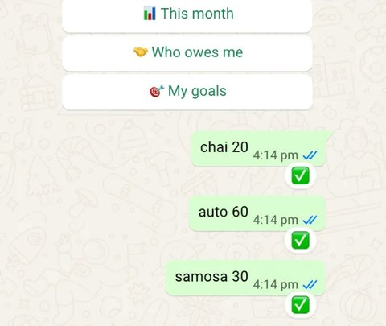
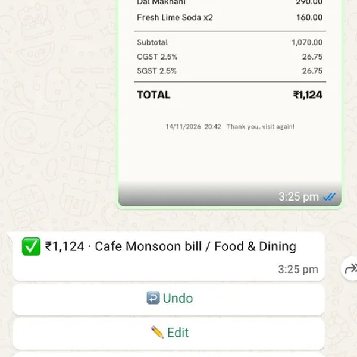
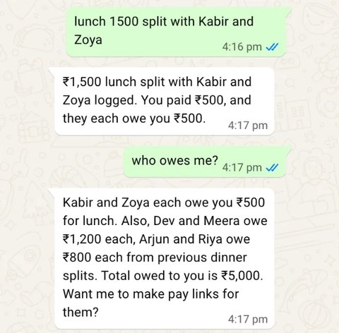
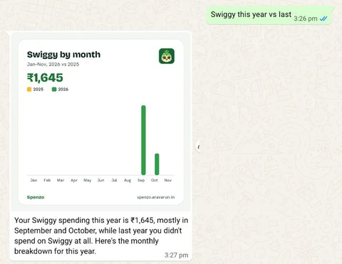
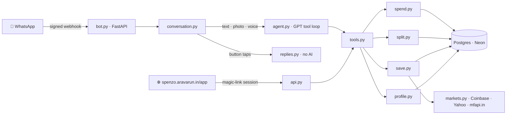

# Spenzo · your personal finance buddy on WhatsApp

**Just text your money.** Spenzo is a personal finance buddy that lives in WhatsApp. Track what you spend, split bills with friends, save for goals and keep an eye on your investments, all by chatting. No app, no forms, no passwords: your WhatsApp number is your account.

**Live:** [spenzo.aravarun.in](https://www.spenzo.aravarun.in) · message Spenzo on WhatsApp at +91 98202 23725

<p align="center">
  
  
  
</p>

---

## What it does

| | You say | Spenzo |
| --- | --- | --- |
| **Spend** | "uber 260", a photo of a bill, a voice note | Logs it with a category, converts foreign money at the live rate, tags merchants and trips. After a few, a plain spend just gets a ✅ reaction |
| | a forwarded bank or card statement PDF | Fills in the month: skips what you already logged, transfers between your own accounts, card payments and SIPs; one tap undoes the import. Locked PDFs ask for the password, which is never stored |
| | "keep food under 6k" | Monthly budget; warns at 80%, at 100%, and if you're spending too fast |
| **Split** | "dinner 3000 split with Arav and Riya", or a bill forwarded from a group | Logs your share and what each friend owes, in both directions; asks who was there if the bill doesn't say |
| | a forwarded "I sent you 500" or a payment screenshot | Settles whoever owed that much |
| | "who owes me?" → your UPI ID | A tap-to-pay link per person ([`/pay`](website/src/pages/Pay.jsx)) to forward |
| **Save** | "Goa trip 30k by March" | A goal with the monthly amount needed; offers to top it up on payday |
| | a screenshot of Groww/Zerodha holdings, or a forwarded CAS statement | Stocks and mutual funds at live prices, plus net worth. Baaz stickers when a goal is half done or reached |
| **See** | "where did my money go?", "can I afford a 40k phone?" | Straight answers from your real numbers, in English, Hinglish or Hindi |
| | "Swiggy this year vs last", "show my spending by category" | A chart picture in the chat |
| | "wrapped" (offered early each month) | A shareable card of last month: top category and spot, your usual, biggest day, no-spend days |
| | tap 📊 | Your dashboard, already signed in |

**Design rules that keep it simple**
- One thing to learn: tell it what you spent. Other features are offered once, when they become useful.
- At most 3 lines, 1 suggestion and 3 buttons per reply. Undo instead of "are you sure?".
- Button taps (Undo, This month, Set budget…) are answered instantly without calling the AI.
- Nudges only ride on replies to something you just did, once per month each. "stop nudges" turns them off.
- Investments get facts (value, gains, concentration), never buy/sell tips.

## Highlights

Screenshots from the live bot on its own WhatsApp number, with made-up data.

<table>
  <tr><td width="33%" valign="top"><b>Log a spend in a second</b><br><sub>After a few, a plain “chai 20” just gets a ✅</sub><br><br></td><td width="33%" valign="top"><b>Forward your bank statement</b><br><sub>Locked PDFs ask for the password, used once</sub><br><br></td><td width="33%" valign="top"><b>Snap the bill</b><br><sub>Bills and payment screenshots are read and logged</sub><br><br></td></tr>
  <tr><td width="33%" valign="top"><b>Split with friends</b><br><sub>Your share logged, everyone else's tracked</sub><br><br></td><td width="33%" valign="top"><b>Goals that cheer you on</b><br><sub>Baaz stickers halfway and at the finish</sub><br><br></td><td width="33%" valign="top"><b>Charts on request</b><br><sub>“Swiggy this year vs last” comes back as a picture</sub><br><br></td></tr>
</table>

## How it works



- **One set of tools.** The WhatsApp agent calls plain Python functions; the dashboard reads the same functions through a small API. Tool schemas are generated from the Python signatures.
- **Users can't reach each other's data.** Tools never take a user argument. The sender's number (WhatsApp) or session (dashboard) sets the user for the request, and every SQL query filters on it.
- **Passwordless.** Dashboard links carry a 15-minute HMAC-signed token in the URL fragment, swapped for a 30-day session. "Sign me out everywhere" revokes them all at once.
- **Plain SQL on Postgres.** One small [`db.py`](server/db.py) over psycopg; totals are computed in the database. Works on Neon, Supabase or any Postgres.
- **WhatsApp Cloud API, direct.** Signature-checked webhooks, duplicate-delivery protection, typing indicator, reply buttons, link buttons, image headers, reactions, stickers and uploaded pictures. Replies to users are free.

```
server/
  core.py          settings, current user, dates
  db.py            Postgres helpers (rows, row, value, execute, transaction)
  spend.py         expenses, income, budgets
  split.py         debts both ways, UPI pay links
  save.py          goals, investments, net worth
  markets.py       FX, NSE/BSE stocks, mutual fund NAVs (cached 15 min)
  statements.py    forwarded PDFs: bank, card and mutual fund statements, receipts
  insights.py      spending charts and the monthly Wrapped; cards.py draws them (Pillow)
  profile.py       name, long-term facts, chat memory, delete-my-data
  nudges.py        one well-timed nudge per reply, recorded once per month
  replies.py       reply format (text + buttons/link) and every no-AI reply
  agent.py         prompt, tool loop, voice transcription
  conversation.py  one message in, replies out
  whatsapp.py      Cloud API: parse, send, reactions, stickers, pictures, typing, media
  bot.py           the server: webhook and dashboard API (api.py)
  auth.py          passwordless dashboard links and sessions
  chat.py          terminal simulator; localdb.py throwaway Postgres for tests
scripts/           setup_db.py · dev.sh (local bot + tunnel) · whatsapp_connect.py (point Meta at the bot)
                   whatsapp_test.py (16-step live test on real WhatsApp)
website/           Vite + React + Tailwind: landing, /app dashboard, /pay, /privacy
schema.sql         the tables
docs/images/       README screenshots (website/public/highlights has the site's copies)
server/assets/     fonts (Bricolage and Hanken Grotesk, OFL) and Baaz art for the pictures
brand/             Baaz the mascot: original art and the WhatsApp profile photo
```

---

## Run it locally

Needs Python 3.12+, [uv](https://github.com/astral-sh/uv) and Node 22.

```bash
uv sync
cp .env.example .env              # OPENAI_API_KEY is enough for the simulator
uv run python -m server.chat --memory
```

A WhatsApp-style chat in your terminal on a throwaway database: buttons show as `[1] [2] [3]`; `/photo bill.jpg`, `/voice note.ogg` and `/pdf statement.pdf` send media, `/fwd text` sends a forwarded message, and pictures Spenzo sends are saved to a temp file.

```bash
cd website && npm install && npm run dev   # http://localhost:5173
```

To try it on real WhatsApp before deploying, fill in `.env` and run `./scripts/dev.sh`. It starts the bot, opens a public tunnel and prints the webhook URL to paste into Meta.

To check a deployed bot end to end, message it once from your phone, then run `BOT_URL=https://YOUR-BOT.onrender.com uv run python scripts/whatsapp_test.py`. It sends a signed webhook, plays a 15-message conversation through the real bot (you'll see the replies on your phone), checks each result in the database and deletes the test data.

## Deploy (free tiers)

1. **Database:** create a free [Neon](https://neon.tech) project, put its connection string in `DATABASE_URL`, and run `uv run python scripts/setup_db.py`.
2. **Bot:** on Render, New → Blueprint → this repo. [`render.yaml`](render.yaml) builds the [`Dockerfile`](Dockerfile) as a free web service and asks for each secret from [`.env.example`](.env.example). Point a free uptime monitor at `https://YOUR-BOT.onrender.com/` every 5 minutes so it doesn't sleep.
3. **WhatsApp:** in a Meta developer app, add WhatsApp and your number, create a permanent System User token, then run `uv run python scripts/whatsapp_connect.py https://YOUR-BOT.onrender.com/webhook`. It sets the webhook, checks Meta verified it, and subscribes your WhatsApp account.
4. **Website:** deploy `website/` to Vercel with `VITE_API_URL` and `VITE_WHATSAPP_NUMBER` ([`website/.env.example`](website/.env.example)).

---

MIT licensed. Investment information is factual and not financial advice.
