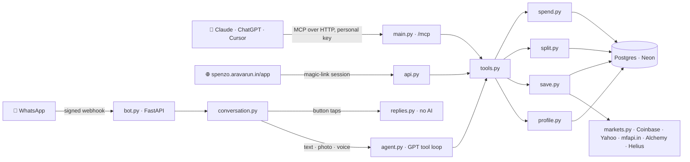

# Spenzo · your money buddy on WhatsApp


**Just text your money.** Spenzo is a money buddy that lives in WhatsApp. Track what you spend, split bills with friends, save for goals and keep an eye on your investments, all by chatting. No app, no forms, no passwords: your WhatsApp number is your account. It also plugs into Claude, ChatGPT and Cursor over MCP.

[spenzo.aravarun.in](https://www.spenzo.aravarun.in)

```
You     chai 20
Spenzo  ✅ ₹20 · Chai / Food & Dining            [↩️ Undo] [✏️ Edit] [📊 This month]

You     dinner 3000 split with Arav and Riya
Spenzo  ✅ ₹1,000 · Dinner / Food & Dining
        Arav and Riya owe you ₹1,000 each 🤝

You     salary aaya 60k
Spenzo  💸 Salary logged!
        Payday! Move ₹7,500 to Goa trip? That keeps it on track.   [Move ₹7,500] [Not now]
```

---

## What it does

| | You say | Spenzo |
| --- | --- | --- |
| **Spend** | "uber 260", a photo of a bill, a voice note | Logs it with a category, converts foreign money at the live rate, tags merchants and trips |
| | "keep food under 6k" | Monthly budget; warns at 80%, at 100%, and if you're spending too fast |
| **Split** | "dinner 3000 split with Arav and Riya" | Logs your share and what each friend owes, in both directions |
| | "who owes me?" → your UPI ID | A tap-to-pay link per person ([`/pay`](website/src/pages/Pay.jsx)) to forward |
| **Save** | "Goa trip 30k by March" | A goal with the monthly amount needed; offers to top it up on payday |
| | a screenshot of Groww/Zerodha holdings | Stocks, mutual funds and crypto wallets at live prices, plus net worth |
| **See** | "where did my money go?", "can I afford a 40k phone?" | Straight answers from your real numbers, in English, Hinglish or Hindi |
| | tap 📊 | Your dashboard, already signed in |
| **Your AI** | "connect ai" | A private link that adds Spenzo to Claude, ChatGPT or Cursor |

**Design rules that keep it simple**
- One thing to learn: tell it what you spent. Other features are offered once, when they become useful.
- At most 3 lines, 1 suggestion and 3 buttons per reply. Undo instead of "are you sure?".
- Button taps (Undo, This month, Set budget…) are answered instantly without calling the AI.
- Nudges only ride on replies to something you just did, once per month each. "stop nudges" turns them off.
- Investments get facts (value, gains, concentration), never buy/sell tips.

## How it works



- **One set of tools, three front doors.** WhatsApp calls the tool functions in-process; AI apps reach the same functions over MCP; the dashboard reads them through a small API. Tool schemas are generated from the Python signatures.
- **Users can't reach each other's data.** Tools never take a user argument. The sender's number (WhatsApp), session (dashboard) or personal key (MCP) sets the user for the request, and every SQL query filters on it.
- **Passwordless.** Dashboard links carry a 15-minute HMAC-signed token in the URL fragment, swapped for a 30-day session. AI links carry a 1-year key. "Sign me out everywhere" revokes all of them at once.
- **Plain SQL on Postgres.** One small [`db.py`](server/db.py) over psycopg; totals are computed in the database. Works on Neon, Supabase or any Postgres.
- **WhatsApp Cloud API, direct.** Signature-checked webhooks, duplicate-delivery protection, typing indicator, reply buttons, link buttons and image headers. Replies to users are free.

```
server/
  core.py          settings, current user, dates
  db.py            Postgres helpers (rows, row, value, execute, transaction)
  spend.py         expenses, income, budgets
  split.py         debts both ways, UPI pay links
  save.py          goals, investments, net worth
  markets.py       FX, NSE/BSE stocks, mutual fund NAVs, crypto wallets (cached 15 min)
  profile.py       name, long-term facts, chat memory, delete-my-data
  nudges.py        one well-timed nudge per reply, recorded once per month
  replies.py       reply format (text + buttons/link) and every no-AI reply
  agent.py         prompt, tool loop, voice transcription
  conversation.py  one message in, replies out
  whatsapp.py      Cloud API: parse, send, typing, media
  bot.py           the server: webhook, dashboard API (api.py), MCP at /mcp (main.py)
  auth.py          signed links; account.py links a local Claude Desktop
  chat.py          terminal simulator; localdb.py throwaway Postgres for tests
scripts/           setup_db.py · dev.sh (local bot + tunnel) · import_v1.py (move v1 data)
tests/             pytest on a real embedded Postgres; no network
website/           Vite + React + Tailwind: landing, /app dashboard, /connect, /pay, /privacy
schema.sql         the tables
brand/             Baaz the mascot: original art and the prompts that made it
```

---

## Run it locally

Needs Python 3.11+, [uv](https://github.com/astral-sh/uv) and Node 22.

```bash
uv sync
cp .env.example .env              # OPENAI_API_KEY is enough for the simulator
uv run python -m server.chat --memory
```

A WhatsApp-style chat in your terminal on a throwaway database: buttons show as `[1] [2] [3]`, and `/photo bill.jpg` or `/voice note.ogg` send media.

```bash
uv run pytest                     # 38 tests on an embedded Postgres, nothing to install
cd website && npm install && npm run dev
```

To try it on real WhatsApp before deploying, fill in `.env` and run `./scripts/dev.sh`. It starts the bot, opens a public tunnel and prints the webhook URL to paste into Meta.

## Deploy (free tiers)

1. **Database:** create a free [Neon](https://neon.tech) project, put its connection string in `DATABASE_URL`, and run `uv run python scripts/setup_db.py`.
2. **Bot:** deploy the [`Dockerfile`](Dockerfile) to Render (free web service) with the variables from [`.env.example`](.env.example). Point a free uptime monitor at `https://YOUR-BOT.onrender.com/` every 10 minutes.
3. **WhatsApp:** in a Meta developer app, add WhatsApp and your number, create a permanent System User token, set the webhook to `https://YOUR-BOT.onrender.com/webhook` with your `WHATSAPP_VERIFY_TOKEN`, and subscribe to `messages`.
4. **Website:** deploy `website/` to Vercel with `VITE_API_URL` and `VITE_WHATSAPP_NUMBER` ([`website/.env.example`](website/.env.example)).

## Your AI (MCP)

Hosted: users send **connect ai** on WhatsApp and get a page with their private URL, `https://YOUR-BOT.onrender.com/mcp?key=…`, plus copy-ready setup for Claude, ChatGPT, Cursor and Claude Code.

Local, for the owner: `uv run fastmcp run server/main.py` serves the same tools over stdio against your own `DATABASE_URL`.

---

MIT licensed. Investment information is factual and not financial advice.
